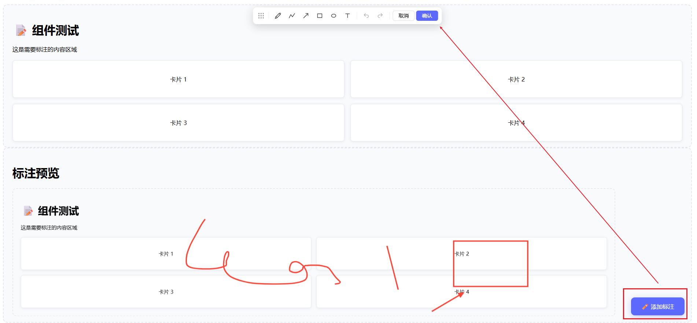

# @laoliangfe/annotation-overlay

[](https://www.npmjs.com/package/@laoliangfe/annotation-overlay)
[](./LICENSE)

一个基于 Fabric.js 的 Vue 3 页面标注组件，支持画笔、矩形、椭圆、箭头、折线和文字标注。

## 🌐 在线演示

[https://love2157dream.github.io/annotation-overlay/](https://love2157dream.github.io/annotation-overlay/)

## 📸 预览



## ✨ 特性

- 🎨 **多种标注工具**：画笔、矩形、椭圆、箭头、折线、文字
- 📦 **基于 Fabric.js 7.x**: 功能强大
- 🚀 **快速截图**：使用 snapdom 替代 html2canvas
- ↩️ **撤销/重做**：完整的操作历史管理
- 🎯 **精确坐标**：支持高 DPI 屏幕
- 📱 **响应式设计**：适配不同屏幕尺寸
- 🎨 **可定制样式**：粗细、颜色、大小
- 🔄 **可拖动工具栏**：避免遮挡内容
- ⌨️ **键盘快捷键**：Ctrl+Z 撤销，Ctrl+Shift+Z 重做

## 📋 环境要求

- Vue 3.x
- Node.js 22.x +

## 📁 目录结构

```text
annotation-overlay/
├── src/                                    # 组件库源码
│   ├── index.ts                            # 库主入口，导出组件和类型
│   ├── AnnotationOverlay.vue               # 核心标注组件
│   └── types.ts                            # TypeScript 类型定义
├── dev/                                    # 开发测试环境
│   ├── index.html                          # 测试页面入口
│   ├── main.ts                             # 测试入口文件
│   └── App.vue                             # 测试用 App 组件
│
├── dist/                                   # 组件库打包产物 (发布到 npm)
│   ├── index.es.js                         # ES Module 格式
│   ├── index.umd.js                        # UMD 格式
│   ├── index.cjs.js                        # CommonJS 格式
│   ├── style.css                           # 组件样式
│   └── index.d.ts                          # TypeScript 类型声明
│
├── docs/                                   # GitHub Pages 演示站点
│   ├── index.html                          # 演示页面
│   ├── style.css                           # 样式文件
│   └── assets/                             # 静态资源
│
├── .github/                                # GitHub 配置
│   └── workflows/
│   └── deploy.yml                          # 自动部署到 GitHub Pages
│
├── .gitignore                              # Git 忽略文件
├── .npmignore                              # npm 发布忽略文件
├── CHANGELOG.md                            # 版本更新日志
├── LICENSE                                 # 开源许可证 (MIT)
├── package.json                            # 项目依赖和配置
├── pnpm-lock.yaml                          # pnpm 锁定文件
├── pnpm-workspace.yaml                     # pnpm 工作区配置
├── tsconfig.json                           # TypeScript 编译配置
├── vite.config.ts                          # 组件库打包配置
└── vite.dev.config.ts                      # 开发/演示打包配置

```


## 📦 安装

```bash
npm install @laoliangfe/annotation-overlay
# 或
yarn add @laoliangfe/annotation-overlay
# 或
pnpm add @laoliangfe/annotation-overlay
```

## 🚀 快速开始

- **全局注册**

```typescript
// main.ts
import { createApp } from 'vue';
import App from './App.vue';
import AnnotationOverlay from '@laoliangfe/annotation-overlay';
import '@laoliangfe/annotation-overlay/style.css';

const app = createApp(App);
app.use(AnnotationOverlay);
app.mount('#app');
```

- **局部使用**
  
```vue
<template>
  <div>
    <button @click="openAnnotation">📝 添加标注</button>
    
    <AnnotationOverlay 
      ref="annoRef" 
      @confirm="handleConfirm" 
      @cancel="handleCancel"
      @before-capture="cleanupBeforeCapture"
    />
    
    <div ref="targetRef" class="content">
      <!-- 你的内容 -->
    </div>
  </div>
</template>

<script setup lang="ts">
import { ref } from 'vue';
import AnnotationOverlay from '@laoliangfe/annotation-overlay';
import '@laoliangfe/annotation-overlay/style.css';

const annoRef = ref<InstanceType<typeof AnnotationOverlay>>();
const targetRef = ref<HTMLElement>();

const openAnnotation = () => {
  if (targetRef.value) {
    annoRef.value?.open(targetRef.value)
  }
};

const handleConfirm = (payload: ConfirmPayload | null) => {
  if (!payload) {
    console.log('未进行任何标注');
    return;
  }
  console.log('标注结果:', payload);
  // 上传或保存
}

const handleCancel = () => {
  console.log('取消标注');
}

const cleanupBeforeCapture = (targetEl: HTMLElement) => {
  targetEl.querySelectorAll('.active, .hover').forEach(el => {
    el.classList.remove('active', 'hover');
  });
}
</script>

```

## 🎯 API

**事件**

| 事件名 | 参数 | 说明 |
| :--: | :--------: | :---------- |
| `confirm` |	`ConfirmPayload \| null` | 	确认标注，无内容时返回 `null` | 
| `cancel` |	- |	取消标注|
| `beforeCapture` |	`targetEl: HTMLElement` |	截图前触发，可用于清理状态 |
| `afterCapture` |	`targetEl: HTMLElement` |	截图后触发，可用于恢复状态 |

**方法**

|方法	|参数	|说明|
| :--:    | :--------:               | :---------- |
| `open`  |	`targetEl?: HTMLElement` |	打开标注组件 |
| `close` |	-	|关闭标注组件|

**使用**

```typescript
const annoRef = ref<InstanceType<typeof AnnotationOverlay>>()

// 打开
annoRef.value?.open(document.querySelector('.target'))

// 关闭
annoRef.value?.close()

```

## ⌨️ 键盘快捷键

| 快捷键|	功能|
| :--: | :---------- |
|Ctrl+Z / Cmd+Z|	撤销|
|Ctrl+Shift+Z / Cmd+Shift+Z|	重做|
|Ctrl+Y / Cmd+Y|	重做|
|ESC	|退出文字编辑 / 取消|

## 🔧 开发

```bash
# 克隆仓库
git clone https://github.com/love2157dream/annotation-overlay.git

# 安装依赖
npm install

# 启动开发服务
npm run dev

# 构建
npm run build

# 运行测试
npm run test
```

## 🤝 贡献

欢迎提交 Issue 和 Pull Request！

## 📄 许可证
MIT © [Liang lei](https://github.com/love2157dream)